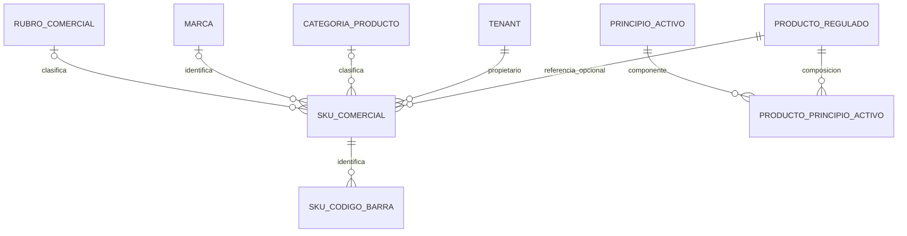
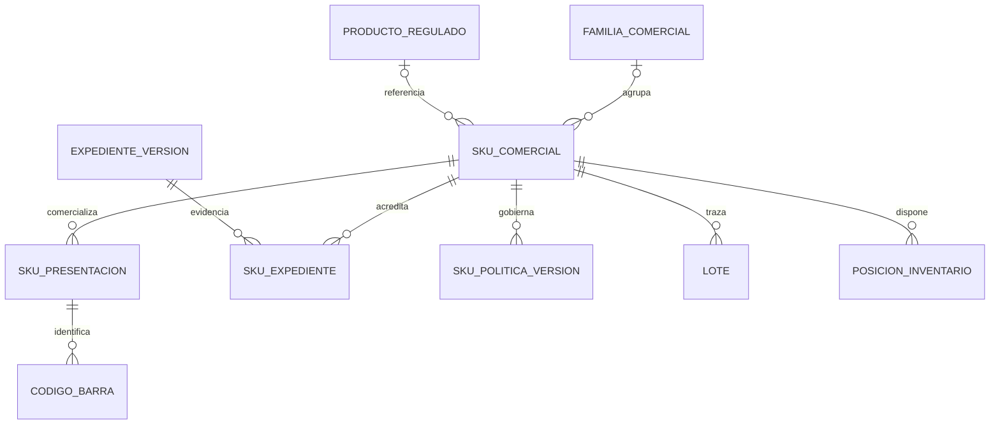

# Análisis del modelo de catálogo: producto, SKU y tablas relacionadas

Fecha: 10 de octubre de 2026. Revisión estática del repositorio y contraste con documentación oficial. Las propuestas siguientes **no son migraciones ejecutadas**.

## 1. Decisión recomendada

**Sí conviene separar producto y SKU. El proyecto ya lo hace parcialmente mediante `producto_regulado` y `sku_comercial`; no recomiendo fusionarlos ni crear otra tabla genérica `producto` sin definir primero su responsabilidad.**

La separación actual distingue referencia sanitaria global y artículo comercial del tenant. Falta resolver agrupación de variantes, presentaciones y conversión a stock, evidencia sanitaria versionada y políticas de venta. Añadir una tabla llamada “producto” por sí sola no resuelve esas necesidades.

Recomiendo conservar las identidades actuales y evolucionar de forma aditiva:

1. **Producto regulado:** referencia sanitaria compartida, con fuente y gobierno central; no representa existencias ni precios de una botica.
2. **Familia comercial opcional:** agrupa variantes del tenant cuando realmente existen, por ejemplo un artículo con tamaños o colores. Puede ser el concepto que la interfaz llame “producto”, pero conviene mantener un nombre inequívoco en el dominio.
3. **SKU comercial:** variante/artículo cuya identidad se utiliza en compras, inventario y ventas. Pertenece al tenant.
4. **Presentación comercial estructurada:** define unidad, cantidad equivalente, código de barras y uso permitido en compra/venta. Necesaria para evitar que “caja”, “blíster” y “unidad” sean solo texto.
5. **Expediente y política sanitaria versionados:** gobiernan evidencia y admisibilidad; no deben quedar reducidos a un booleano “regulado”.

El [ADR-011 existente](../cadena-farmacias-docs/docs/05-arquitectura/adr/ADR-011-surtido-trazabilidad-admisibilidad.md) ya decide documentalmente varias de estas separaciones. El [diseño detallado de surtido](../cadena-farmacias-docs/docs/06-datos/10-diseno-detallado-surtido.md) propone familia, expediente y políticas; esas propuestas no equivalen a tablas migradas ni a funcionalidad terminada. La recomendación respeta esa dirección y precisa especialmente presentaciones y unidades.

## 2. Modelo actual comprobado

Fuentes: [V003](../cadena-farmacias-docs/database/migrations/V003__catalogo_farmaceutico.sql), [migraciones posteriores](../../service-botica/bootstrap-app/src/main/resources/db/migration), [SKUComercial](../../service-botica/modules/catalogo/src/main/java/com/softprimesolutions/catalogo/domain/model/SKUComercial.java), [SkuRequest](../../service-botica/modules/catalogo/src/main/java/com/softprimesolutions/catalogo/api/dto/request/SkuRequest.java) y [entidad JPA](../../service-botica/modules/catalogo/src/main/java/com/softprimesolutions/catalogo/infrastructure/persistence/write/entity/SkuComercialJpaEntity.java).

El diagrama expresa relaciones del DDL; no implica que todas estén expuestas por API.

| Concepto | Estado actual | Consecuencia |
| --- | --- | --- |
| Referencia sanitaria | Global, sin tenant en `producto_regulado` | Una modificación puede afectar referencias usadas por varios tenants; requiere gobierno de datos compartidos. |
| SKU | Tiene tenant y referencia regulada opcional | Separación adecuada para datos comerciales propios. |
| Producto no regulado | Puede existir directamente como SKU | Válido para artículos simples; no hay agrupador implementado para variantes. |
| Familia/variantes | JSONB `atributos_variante` en SQL, sin familia migrada | No hay definición tipada ni unicidad de combinación acreditada. |
| Presentación | Texto y un único factor/unidad de fracción | Insuficiente para expresar varios empaques y su efecto uniforme sobre el stock. |
| Rubro/NSO/código SUNAT/atributos | Columnas SQL ausentes de SkuRequest y entidad JPA revisados | El CRUD habitual del SKU no administra íntegramente el esquema. |
| Precio de referencia | Añadido posteriormente en V037 | No sustituye listas, vigencias, impuestos ni autorización de descuentos. |
| Disponibilidad | Posiciones de inventario referidas a SKU y lote | La familia y el producto regulado no deben acumular stock independiente. |

Un principio activo compartido no convierte dos marcas, concentraciones, formas o fabricantes en un mismo SKU. Tampoco prueba equivalencia terapéutica. Un número de registro no debe usarse como identificador comercial universal; sus presentaciones y alcance deben verificarse contra la fuente competente.

## 3. Cuándo crear cada identidad

| Situación | Tratamiento recomendado |
| --- | --- |
| Mismo SKU en dos establecimientos del tenant | Conservar SKU; diferenciar posición de inventario, precio aplicable y política local. |
| Dos tenants venden la misma referencia | SKU propio de cada tenant; referencia global compartida si corresponde. |
| Nueva marca, concentración o forma farmacéutica | Revisar identidad sanitaria y crear SKU distinto; no resolverlo como atributo cosmético. |
| Pañales de distinta talla o paquete | Familia opcional y SKU por variante comercial identificable. |
| Cambio de lote o vencimiento | Nuevo lote cuando corresponde; no nuevo producto ni nuevo SKU por ese solo hecho. |
| Nueva oferta o precio | Regla/lista/promoción; no clonar SKU. |
| Pack promocional de productos distintos | Composición/kit con reglas de consumo de componentes; no convertirlo a un simple factor. |
| Nueva presentación sellada con identificación propia | SKU separado o presentación identificada según política de inventario explícita; preservar trazabilidad de la presentación. |
| Venta de unidades extraídas de una caja | Conversión autorizada y registrada; nunca solo permitir decimales arbitrarios. |
| Nuevo registro o renovación | Evidencia sanitaria y versiones; evaluar identidad de producto sin sobrescribir historia transaccional. |

GS1 exige un nuevo GTIN ante cambios del contenido neto declarado. Esto respalda conservar la identidad de cada artículo comercial identificado; **no prescribe una tabla SQL ni establece una equivalencia universal GTIN = SKU**. [Regla oficial GS1](https://www.gs1.org/1/gtinrules/en/rule/266/declared-net-content).

## 4. Caja, blíster y unidad: decisión prioritaria

Ejemplo meramente técnico: una caja contiene 10 blísteres de 10 unidades. La autorización real para fraccionar depende del artículo y de la política sanitaria; el ejemplo no la presupone.

### Alternativa A: stock base común con presentaciones

Definir unidad base UNIDAD; presentaciones UNIDAD = 1, BLÍSTER = 10 y CAJA = 100. Comprar 2 cajas incrementa 200 unidades base. Vender 3 blísteres descuenta 30; vender 2 unidades descuenta 2. Quedan 168 unidades base del lote correspondiente.

Persistir en cada línea: presentación, cantidad comercial, factor aplicado, cantidad base, unidad base, precio por presentación y costo convertido. El factor debe quedar como snapshot histórico: cambiarlo mañana no puede reinterpretar una recepción anterior.

Esta alternativa simplifica saldo total, pero **no demuestra cuántas cajas siguen selladas**. Si ese dato determina la venta o el despacho, se necesita estado de empaque o la alternativa B. No reconstruir cajas selladas dividiendo el saldo entre 100.

### Alternativa B: SKU por empaque físico y conversión explícita

Mantener existencias separadas por caja sellada y unidad/fracción. Abrir una caja ejecuta una operación atómica de transformación: consume el SKU caja y genera las cantidades de destino, conservando lote, vencimiento y costo total. Impedir que la misma caja quede disponible simultáneamente como caja y como unidades.

Es más compleja, pero apropiada cuando el empaque sellado tiene identidad y disponibilidad comercial propia. Puede requerir blíster como nivel adicional. La operación de apertura no es una compra nueva ni una venta ficticia.

### Recomendación para este proyecto

Documentar primero cuál alternativa gobierna cada clase de artículo. Para artículos divisibles con stock homogéneo, una unidad base y presentaciones es una base razonable; para empaques cuya integridad debe distinguirse, usar transformación explícita. La aplicación actual no acredita ninguna de las dos de extremo a extremo.

La documentación de Odoo distingue unidades y empaques y contempla unidades de compra diferentes. Es una referencia funcional, no una obligación de copiar su modelo. [Unidades](https://www.odoo.com/documentation/19.0/es/applications/inventory_and_mrp/inventory/product_management/configure/uom.html), [empaques](https://www.odoo.com/documentation/19.0/applications/inventory_and_mrp/inventory/product_management/configure/packaging.html).

Invariantes mínimas propuestas:

- Cantidad base = cantidad comercial × factor versionado, con precisión y redondeo explícitos.
- Una unidad indivisible no admite saldos de media unidad por un decimal arbitrario.
- La cantidad y el costo deben conservarse en apertura, anulación y devolución.
- FEFO y disponibilidad operan sobre la misma unidad base que descuenta la venta.
- El código escaneado identifica presentación y cantidad; no solo el nombre del SKU.
- Una conversión de unidades físicas no cambia concentración, composición ni forma farmacéutica.

## 5. Revisión de las 14 tablas del catálogo

Las trece primeras están en V003; identidad está en [V018](../cadena-farmacias-docs/database/migrations/V018__catalogo_tipo_documento_identidad_sunat.sql). Deben considerarse los ALTER posteriores; el [inventario de tablas](2026-10-10-inventario-tablas.md) distingue creación y evolución.

| Tabla | Decisión | Observación y mejora concreta |
| --- | --- | --- |
| `condicion_venta` | Conservar global | Separar condición de venta de política de local/canal. Mantener fuente y vigencia; validar intervalos y definir cómo se conserva la condición aplicada a una venta. Los indicadores de receta/retención deben ser consumidos por dispensación. |
| `forma_farmaceutica` | Conservar global | Es una característica sanitaria, no presentación comercial. No mezclar “tableta” con “caja x 100”. Preservar códigos y fuente; inactivar referencias sin romper historia. |
| `via_administracion` | Conservar global | Mantener independencia de forma. Si la fuente admite varias vías por producto, introducir relación múltiple; no asumir esa necesidad para todas las referencias ni concatenar códigos en texto. |
| `unidad_medida` | Conservar y precisar | Se usa para venta, contenido y composición, pero no modela dimensiones ni conversiones. Añadir dominio/dimensión y compatibilidad cuando se implementen conversiones. Diferenciar unidad física y equivalencia fiscal SUNAT si no existe correspondencia directa. “Caja” requiere un factor por artículo, no un factor global universal. |
| `clasificacion_controlada` | Conservar global | Es distinta de condición de venta. Sus atributos deben convertirse en validaciones y evidencia de dispensación. Versionar cambios normativos sin cambiar retrospectivamente decisiones. No inferir permiso de venta solo por tener una FK. |
| `principio_activo` | Conservar global | La identidad debe atender fuente, denominación y sinónimos. El índice por denominación exacta no resuelve duplicados por escritura. Normalizar con criterio farmacéutico; no fusionar automáticamente sales o variantes por similitud de texto. |
| `producto_regulado` | Conservar como referencia sanitaria | Reúne registro, descripción, composición referenciada y datos regulatorios. Evitar convertirlo en el producto comercial universal. Precisar autoridad/régimen en identidad de registro; separar evidencia/versiones siguiendo ADR-011. Titular, fabricante y marca son conceptos diferentes. Normalizar organizaciones solo cuando se necesiten relaciones, identidad y búsquedas propias. |
| `producto_principio_activo` | Conservar relación | Permite varios ingredientes; no volver a columnas ingrediente_1/2. Para concentraciones como mg/5 mL faltan numerador/denominador estructurados. Mantener texto original y añadir estructura cuando se necesiten comparaciones fiables; no calcular equivalencias desde texto libre. Revisar precisión y orden de componentes. |
| `categoria_producto` | Conservar por tenant | Jerarquía útil, pero requiere prevención de ciclos y coherencia del nivel. Calcular nivel o mantenerlo transaccionalmente. Una categoría principal basta para clasificación; múltiples categorías de navegación serían relación adicional, solo si el canal lo necesita. |
| `marca` | Conservar por tenant | No equivale a fabricante/importador/titular. Evitar una tabla de “laboratorio” que mezcle esos roles. Unificar marcas globalmente únicamente con gobierno y casos de uso que lo justifiquen. |
| `rubro_comercial` | Conservar por tenant | Clasificación comercial amplia. No expresa autorización sanitaria. Conectar realmente `sku.rubro_id` al CRUD. `producto_regulado.rubro_codigo` global y rubro tenant no son una misma FK ni deben sincronizarse por coincidencia textual. |
| `sku_comercial` | Conservar y completar | Identidad transaccional del tenant. Añadir familia opcional y presentaciones; completar contrato de campos existentes; separar política sanitaria/versiones. Mantener contenido, peso y dimensiones ligados a una presentación definida. No mover stock, costos, listas de precio o lotes a la familia. |
| `sku_codigo_barra` | Conservar y extender según presentación | Varios códigos por SKU es correcto. Si el código distingue caja/blíster, asociarlo a presentación. Validar formato según tipo y preservar ceros iniciales. Aplicar estado, baja y vigencia en búsquedas. Definir si un principal inactivo puede bloquear la designación de otro y política de reutilización. |
| `tipo_documento_identidad` | Conservar referencia transversal | Se usa más allá de catálogo comercial: clientes/proveedores/operaciones fiscales. No necesita convertirse en producto ni trasladarse a seguridad por su nombre. Validar documento según país/tipo/contexto; la existencia del código no prueba admisibilidad en cualquier comprobante. |

Los estándares de DIGEMID constituyen referencia oficial para clasificaciones farmacéuticas; su disponibilidad no convierte el catálogo local en una sincronización ni garantiza actualización automática. [Estándares oficiales](https://www.digemid.minsa.gob.pe/webDigemid/estandares-de-productos-farmaceuticos/).

## 6. Hallazgos adicionales verificables

Estos identificadores continúan OBS-001–019 de los informes previos. Son hallazgos estáticos; los escenarios propuestos aún necesitan ejecución controlada.

### OBS-020 — Media: esquema SKU y contrato de aplicación incompletos

**Evidencia:** V003 contiene `rubro_id`, `codigo_nso`, `codigo_estandar_sunat` y `atributos_variante`; faltan en SkuRequest, SKUComercial y SkuComercialJpaEntity revisados.

**Impacto:** la presencia de columnas y de un CRUD de rubros no acredita clasificación de SKU por rubro ni administración de variantes por el flujo ordinario.

**Acción:** definir fuente canónica y completar cada campo a través de frontend, DTO, dominio, lectura y escritura. La NSO debe alinearse con expediente/evidencia del ADR-011, evitando otra edición independiente.

**Aceptación:** guardar y recuperar un SKU con rubro y atributos tipados válidos; rechazar rubro de otro tenant y atributos incompatibles. No dar por implementado por agregar campos visuales.

### OBS-021 — Media: CHECK de fracción admite factor NULL

**Evidencia:** `ck_sku_factor` tiene rama `permite_venta_fraccion = TRUE AND factor_fraccion > 0 AND unidad_fraccion_codigo IS NOT NULL`, sin `factor_fraccion IS NOT NULL`.

Con permite = true, factor = NULL y unidad informada, la expresión completa evalúa NULL. PostgreSQL acepta CHECK verdadero o NULL. La validación Java sí rechaza ese factor: es una inconsistencia entre capas y un riesgo para cargas/escrituras que no pasan por el dominio. [Semántica oficial de CHECK](https://www.postgresql.org/docs/current/ddl-constraints.html).

**Acción:** añadir nulabilidad explícita a la rama positiva mediante nueva migración, previa búsqueda de datos incompatibles. Repetir para restricciones condicionales similares.

**Aceptación:** un INSERT SQL controlado con la combinación inválida falla; fracción válida y SKU sin fracción siguen admitidos. No se ejecutó ese INSERT contra una base desplegada.

### OBS-022 — Media: jerarquía de categorías sin prevención de ciclos

**Evidencia:** [modelo](../../service-botica/modules/catalogo/src/main/java/com/softprimesolutions/catalogo/domain/model/CategoriaProducto.java), [handler](../../service-botica/modules/catalogo/src/main/java/com/softprimesolutions/catalogo/application/usecase/command/ActualizarCategoriaProductoHandler.java) y [adaptador](../../service-botica/modules/catalogo/src/main/java/com/softprimesolutions/catalogo/infrastructure/persistence/write/adapter/CatalogoComercialJpaWriteAdapter.java), método `save(CategoriaProducto)`. Se valida existencia del padre y nivel positivo; no hay comprobación de ancestros en ese flujo. La FK SQL por tenant evita padre de otro tenant, pero no ciclos.

**Escenarios:** asignar A como padre de A; crear A → B y luego B → A; cambiar padre dejando nivel incongruente.

**Impacto:** navegación y consultas recursivas pueden resultar inconsistentes. No se afirma que la interfaz actual entre en bucle.

**Acción:** impedir autorreferencia y ciclos, controlar concurrencia de reparentado y calcular/revalidar niveles de descendientes.

### OBS-023 — Media: búsqueda por barcode ignora estado y vigencia

**Evidencia:** [CatalogoJdbcReadRepository](../../service-botica/modules/catalogo/src/main/java/com/softprimesolutions/catalogo/infrastructure/persistence/read/repository/CatalogoJdbcReadRepository.java), `SKU_FILTER`: el EXISTS sobre `sku_codigo_barra` comprueba tenant, SKU y texto; no filtra `estado`, `es_activo`, `vigente_desde` ni `vigente_hasta`.

**Impacto:** un código inactivo, dado de baja, futuro o vencido puede encontrar un SKU en esa consulta. No se extrapola automáticamente a toda ruta de escaneo sin probar el consumidor.

**Acción:** separar búsqueda histórica administrativa de resolución operativa de código; esta última debe aplicar vigencia con una fecha de negocio consistente.

**Aceptación:** cinco casos —activo vigente, inactivo, baja, futuro y expirado— y código de otro tenant. Solo el primero resuelve en operación normal.

### Invariantes pendientes de decisión

No se clasifican como errores confirmados sin cerrar la política:

- `NO_REGULADO` actualmente puede conservar `producto_regulado_id`; el CHECK solo obliga la referencia para REGULADO. Definir si eso es admisible antes de imponer exclusión, especialmente porque el ADR abandona esa dicotomía como regla sanitaria suficiente.
- `contenido` y `unidad_contenido_codigo` requieren coherencia conjunta si se informan. El dominio valida longitud y positividad parcial, pero debe expresar el par completo.
- `requiere_vencimiento ⇒ requiere_lote` es la política propuesta en ADR-011; alinearla en DTO/dominio/SQL e inventario.
- Estados de negocio y baja lógica tienen semánticas distintas. Unificar filtros por caso de uso; no borrar referencias históricas para resolver conflictos de unicidad.
- Identificadores maestros ya usados en stock o venta deben tener reglas de cambio: modificar concentración, unidad base o factor no puede reinterpretar historia.
- Una tabla global requiere permisos y trazabilidad de mantenimiento distintos de los datos comerciales de tenant. Revisar expresamente ese límite antes de carga masiva o publicación.

## 7. Modelo objetivo conceptual y mínimo de campos

Es un modelo conceptual propuesto, no un diagrama fiel de tablas ya existentes. La vinculación exacta expediente/cabecera/versiones debe consolidarse con ADR-011 antes de escribir DDL.

| Entidad propuesta | Campos/invariantes mínimos |
| --- | --- |
| Familia comercial | tenant, UUID, código, nombre, definición de atributos, estado. Sin stock ni precio transaccional. |
| SKU con variantes | familia opcional; atributos validados por definición y combinación única dentro de familia/tenant; cambios de identidad controlados. |
| Presentación SKU | tenant, SKU, código, unidad, factor a base, precisión, flags de compra/venta, vigencia y versión. No permitir factor cero ni cambio retroactivo. |
| Código de presentación | tenant, presentación, tipo, valor como texto, principal, estado y vigencia. Resolver ambigüedad en una misma fecha. |
| Expediente/versiones | autoridad, régimen, número cuando exista, fuente, evidencia, vigencias, estado y revisión; versiones publicadas inmutables. No inventar números para casos sin registro. |
| Política de SKU | referencias a versiones, trazabilidad requerida, ámbito, vigencia y resultado de admisibilidad. Registrar evidencia de decisión en la operación. |

No recomiendo introducir ahora tablas genéricas EAV para todos los atributos, un catálogo universal de objetos ni duplicar fabricante/marca/titular sin casos claros. JSONB tipado y validado puede servir para atributos de variantes; ingredientes, claves, factores y relaciones sanitarias requieren estructura explícita.

## 8. Impacto sobre las demás tablas y módulos

| Área | Cambio que debe acompañar al catálogo |
| --- | --- |
| Compras | Unidad/presentación del proveedor, factor histórico y costo por unidad base; conservar cantidades pedidas/recibidas comparables. |
| Inventario | Unidad base estable; FK coherente tenant–SKU–lote; admitir ausencia de lote solo según política; cantidades y costos conservados. Revisar unicidad con NULL antes de hacer lotes opcionales. |
| Ventas | Selección de presentación, cantidad base, precio/impuesto calculados, receta/admisibilidad y snapshots; no confiar en un decimal del frontend como fraccionamiento. |
| Precios/promociones | Precio por presentación, vigencia, canal/local y autorización de descuentos. No reutilizar precio de referencia como única fuente. |
| Devoluciones/anulación | Invertir las cantidades y costos históricos, respetar presentación, lote y estado del producto devuelto. |
| Fiscal | Mapeo de unidad/código e impuestos y comprobante; no convertir un ticket interno en CPE por agregar un campo. |
| Frontend | Separar ficha sanitaria, edición comercial y presentaciones; visualizar equivalencias, restricciones y saldo con unidades explícitas. |
| Auditoría | Registrar cambios de datos maestros, políticas y evidencia; autor/fecha en fila no reemplazan historial. |
| Búsqueda | Índices según consultas reales: tenant/código, barcode operativo y descripción. Medir EXPLAIN con datos representativos antes de añadir índices por intuición. |

Las brechas actuales de costo, fraccionamiento, lote obligatorio, impuestos y estado regulatorio se detallan en [OBS-007–019](2026-10-10-revision-integral-modulos.md). El rediseño debe cerrar el circuito completo y no limitarse a DDL.

## 9. Secuencia de implementación recomendada

1. Congelar glosario y unidad base por clase de artículo. Resolver sellado/fraccionado y límites de mutabilidad.
2. Perfilar datos existentes: duplicados, referencias, NULL condicionales, categorías cíclicas, códigos vencidos, factores y saldos. Esta auditoría no accedió a datos reales.
3. Corregir invariantes y filtros de OBS-020–023 mediante cambios pequeños verificables.
4. Crear presentaciones y persistir factor/cantidades históricas en compras, stock y ventas; migrar únicamente equivalencias verificadas.
5. Incorporar familia/atributos cuando existan variantes reales; no exigir familias artificiales para cada SKU sencillo.
6. Implementar expediente/políticas y publicación siguiendo ADR-011; conservar datos históricos y decisiones.
7. Completar precios, dispensación y fiscalidad y validar procesos integrales antes de declarar equivalencia comercial.
8. Migrar de forma aditiva con conciliación de cantidades y valor; no reescribir V003 ni eliminar tablas referenciadas. Prever lectura transitoria y reversión operativa.

## 10. Pruebas de aceptación específicas pendientes

| Caso | Resultado esperado |
| --- | --- |
| Dos tenants, misma referencia sanitaria | Datos comerciales aislados; mantenimiento global controlado. |
| Caja 100, blíster 10, unidad 1 | Compra/venta/anulación conservan cantidad base y costo. |
| Caja parcialmente abierta | No se ofrece como sellada sin evidencia de empaque disponible. |
| Cantidad equivalente a 1,5 unidades indivisibles | Rechazo con explicación de unidad permitida. |
| Cambio de factor tras recepción | Historia, costo y saldos anteriores permanecen iguales. |
| Dos presentaciones con códigos distintos | Cada lectura resuelve su cantidad/presentación correcta. |
| Código inactivo/futuro/vencido | No resuelve como código operativo vigente. |
| Variante duplicada con JSON en distinto orden | Rechazo por igualdad canónica, no solo hash textual. |
| Ingrediente con concentración mg/5 mL | Numerador/denominador y texto original conservados. |
| Referencia suspendida después de abrir carrito | Confirmación reevalúa política vigente y conserva evidencia. |
| Artículo sin lote ni vencimiento | Recepción y venta posibles cuando la política lo permite. |
| Artículo que vence sin lote | Rechazo conforme a la política acordada. |
| Categoría como su propio padre o ciclo A/B | Rechazo, también bajo actualizaciones concurrentes. |
| SQL directo con factor NULL y fracción activa | Rechazo por restricción, no solo por Java. |
| Baja de maestro referenciado | Historia consultable y nuevas operaciones sujetas a estado. |
| Migración de catálogo existente | Totales de stock y valoración conciliados antes/después. |

**Conclusión:** mantener la separación sanitaria/comercial, incorporar presentaciones coherentes con el stock y usar familia comercial solo para variantes reales. El mayor riesgo actual está en que los atributos del catálogo no gobiernan consistentemente compras, inventario y venta; aumentar el número de tablas sin cerrar esos procesos no lo corrige.

